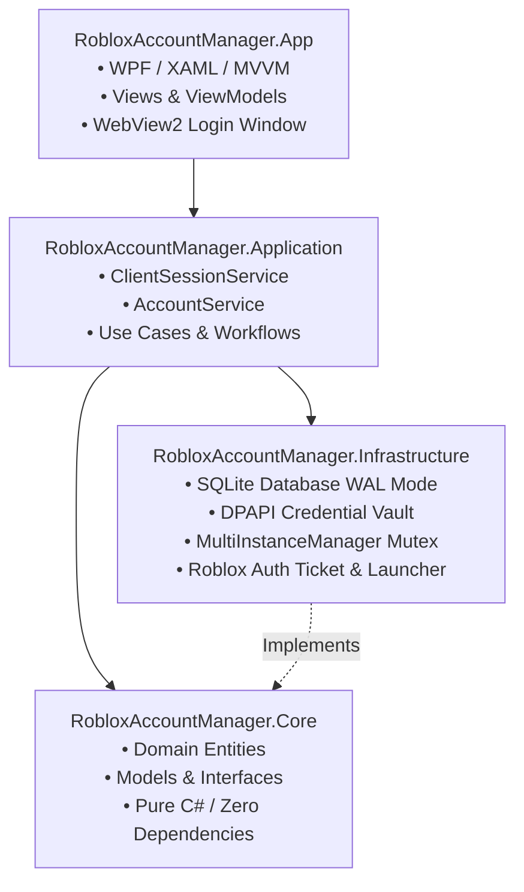

<div align="center">

  

  # Roblox-sessions
  ### High-Performance Multi-Instance Roblox Session Manager & Secure Vault
  **Developed with precision by [TheEgos](https://github.com/ace347)**

  <p align="center">
    <a href="https://github.com/ace347/Roblox-Manager-Plus/releases"></a>
    <a href="https://dotnet.microsoft.com/"></a>
    
    
    
    <a href="LICENSE"></a>
  </p>

  <p align="center">
    <b>A modern, high-speed, local-first Roblox desktop client manager enabling simultaneous multi-instance gaming, seamless one-click authentication, and zero-telemetry credential encryption.</b>
  </p>

</div>

---

## ⚡ Highlights & Key Capabilities

- **🚀 Simultaneous Multi-Instance Launching:** Seamlessly run multiple Roblox accounts at the exact same time on a single PC. Powered by proactive kernel synchronization object handling (`ROBLOX_singletonMutex` & `ROBLOX_singletonEvent`) — zero external handle-closers or batch scripts needed.
- **🔑 One-Click Direct Roblox Login:** Embedded Microsoft WebView2 login window navigates directly to official Roblox endpoints. Safely captures your authenticated session cookie with zero plain-text password exposure.
- **🔐 Hardware-Bound DPAPI Encryption:** All `.ROBLOSECURITY` session tokens are encrypted on disk via Windows Data Protection API (`CurrentUser` scope) with cryptographically randomized per-record entropy. Sensitive buffers are scrubbed from RAM immediately after use with `CryptographicOperations.ZeroMemory`.
- **🎯 Real-Time Process & Session Monitor:** Live tracking of all running Roblox Player processes (`RobloxPlayerBeta.exe`), process IDs (PIDs), start times, launch modes, and authentication handoffs.
- **● Live Status Indicators:** Accounts Vault dynamically reflects which profiles are currently running with glowing emerald `● RUNNING` badges and direct one-click `⏹ Close Session` controls.
- **🎨 Sleek Cyber-Dark Presentation:** Handcrafted WPF theme with dark-themed dropdown controls, custom dark minimalist scrollbars, instant profile search, category tags, and responsive layouts.
- **🛡️ 100% Defensive Security:** Zero DLL injection, zero memory modification, zero scraping of external third-party browsers (Chrome/Edge/Firefox), and strictly zero analytics or phoning home.

---

## 📸 Overview & Interface

```
┌────────────────────────────────────────────────────────────────────────┐
│  [🦚 Logo] Roblox-sessions by TheEgos                                  │
├──────────────┬─────────────────────────────────────────────────────────┤
│  📊 Dashboard│  Roblox Player Sessions              [🧹 Clear] [🔄]    │
│  👥 Accounts │  ┌────────────────────────────────────────────────────┐ │
│  ▶ Sessions  │  │ SELECT PROFILE: [ ace1sigdel (Ego_Ace)   ▼ ]      │ │
│  ⚡ Activity  │  │                                [▶ Launch Roblox]   │ │
│  🔒 Security │  └────────────────────────────────────────────────────┘ │
│  ⚙️ Settings  │                                                         │
│              │  ┌────────────────────────────────────────────────────┐ │
│              │  │ ● RUNNING                                          │ │
│              │  │ ace1sigdel (Ego_Ace)               [⏹ Close Session]│ │
│              │  │ PID: 22960 • Launched: 5:40 AM • Authenticated     │ │
│              │  └────────────────────────────────────────────────────┘ │
└──────────────┴─────────────────────────────────────────────────────────┘
```

---

## 🏗️ Architecture & Clean Design

The application follows strict **Domain-Driven Clean Architecture** and **Dependency Inversion** principles:



### Layer Responsibilities

| Project | Responsibility | Dependencies |
| :--- | :--- | :--- |
| **`RobloxAccountManager.Core`** | Domain models (`Account`, `ClientSession`), abstract service contracts (`IRobloxLauncher`, `ICredentialVault`, `IRobloxMultiInstanceManager`), domain exceptions. | **None** (Pure .NET) |
| **`RobloxAccountManager.Application`** | Business logic, session orchestration, lifecycle validation, duplicate prevention. | `Core` |
| **`RobloxAccountManager.Infrastructure`** | SQLite storage with WAL journaling, DPAPI cryptography, official `auth.roblox.com` ticket negotiation, process inspection, system mutex locks. | `Core`, `Microsoft.Data.Sqlite`, `Serilog` |
| **`RobloxAccountManager.App`** | Modern WPF UI, CommunityToolkit MVVM ViewModels, dark styling templates, WebView2 integration, application composition root. | `Core`, `Application`, `Infrastructure`, `WebView2` |

---

## 🔒 Security Architecture & Defensive Model

Security is paramount when handling account tokens. **Roblox-sessions** adheres to the following hard non-negotiable rules:

1. **No External Browser Scraping:** RAM Plus never attempts to read, open, or decrypt cookie databases belonging to Google Chrome, Microsoft Edge, Mozilla Firefox, or Brave.
2. **DPAPI Protected Storage:** Cookies are encrypted via Windows Data Protection API using `DataProtectionScope.CurrentUser`. A token encrypted by one Windows user cannot be read by any other user or process on another machine.
3. **Volatile Memory Sanitization:** Cryptographic keys and plaintext cookie strings are held in transient unmanaged byte buffers (`SensitiveBuffer`) that explicitly zero their memory allocations using `CryptographicOperations.ZeroMemory` upon disposal.
4. **No Process Code Injection:** Roblox client executables (`RobloxPlayerBeta.exe`) are launched through official Windows protocols (`roblox-player:` scheme). The app **never** injects DLLs, writes to remote process memory, or alters the client binary.
5. **Zero Telemetry:** The application makes network calls exclusively to official Roblox endpoints requested by the user (`auth.roblox.com` for launch tickets, `users.roblox.com` for username lookups, and WebView2 for sign-in). No analytics, ping-backs, or third-party servers exist in the codebase.

---

## 🚀 Getting Started

### System Requirements
- **OS:** Windows 10 (Version 19041+) or Windows 11 (64-bit)
- **Runtime:** .NET 10 Desktop Runtime (included in self-contained release)
- **Roblox:** Official Windows desktop client (`RobloxPlayerBeta.exe`) installed

### Direct Download (Single-File Executable)
1. Download the latest release from the [GitHub Releases](https://github.com/ace347/Roblox-Manager-Plus/releases) page:
   ```
   RobloxAccountManager.App.exe
   ```
2. Double-click to launch. It is fully self-contained with zero installation required.

---

## 🎮 How to Use

### 1. Add Accounts
- **One-Click Login (Recommended):** Click **`🔑 Login with Roblox`** in the Accounts Vault. Sign in securely through the embedded official Roblox page. Once authenticated, your profile is automatically saved with hardware-encrypted credentials.
- **Manual Add:** Click **`+ Add Account`** to enter your username, tag category (e.g., *Main*, *Alt*, *Trader*), and optional `.ROBLOSECURITY` cookie.

### 2. Multi-Instance Launching
- Navigate to **Sessions** or **Accounts**.
- Click **`▶ Launch in Roblox Player`** on your primary account.
- While the first account is playing, click **`▶ Launch`** on any other account. Both accounts will open in separate, independent, authenticated game windows!

### 3. Session Management
- Monitor all active windows with real-time PID and launch duration tracking.
- Click **`⏹ Close Session`** directly from the Accounts Vault or Sessions monitor to gracefully terminate any specific account's process.
- Click **`🧹 Clear Inactive`** to dismiss completed session history.

---

## 🛠️ Building from Source

### Prerequisites
- [.NET 10 SDK (x64)](https://dotnet.microsoft.com/download/dotnet/10.0)
- PowerShell 7+ or Windows PowerShell 5.1

### Compilation & Verification

Clone the repository and run the automated verification scripts:

```powershell
# 1. Clone repository
git clone https://github.com/ace347/Roblox-Manager-Plus.git
cd Roblox-Manager-Plus

# 2. Build the solution (0 warnings, 0 errors)
./scripts/build.ps1

# 3. Run all 99 automated unit & integration tests
./scripts/test.ps1

# 4. Verify secret scanner
./scripts/git-check-secrets.ps1

# 5. Publish portable single-file executable
./scripts/publish.ps1
```

The compiled standalone binary will be located at:
`publish/RobloxAccountManager.App.exe`

---

## 🧪 Automated Test Suite

The solution contains 99 automated unit, integration, stress, and security tests:

```
Test Run Summary:
  ✔ RobloxAccountManager.Core.Tests            (7 passed)
  ✔ RobloxAccountManager.Application.Tests     (15 passed)
  ✔ RobloxAccountManager.Infrastructure.Tests  (62 passed)
  ✔ RobloxAccountManager.App.Tests             (15 passed)
  ---------------------------------------------------------
  Total: 99 passed, 0 failed, 0 skipped (100% Success)
```

---

## 📄 License & Legal Notice

This project is open-source under the [MIT License](LICENSE).

**Disclaimer:** *Roblox is a registered trademark of Roblox Corporation. Roblox-sessions is an independent software project developed by TheEgos and is not affiliated with, endorsed by, or sponsored by Roblox Corporation.*
