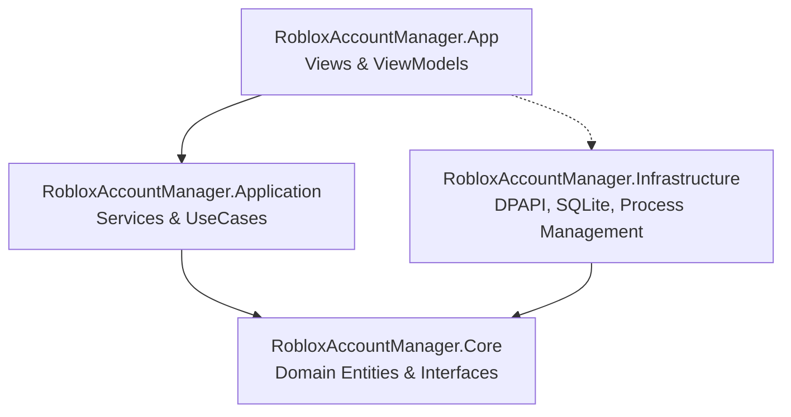
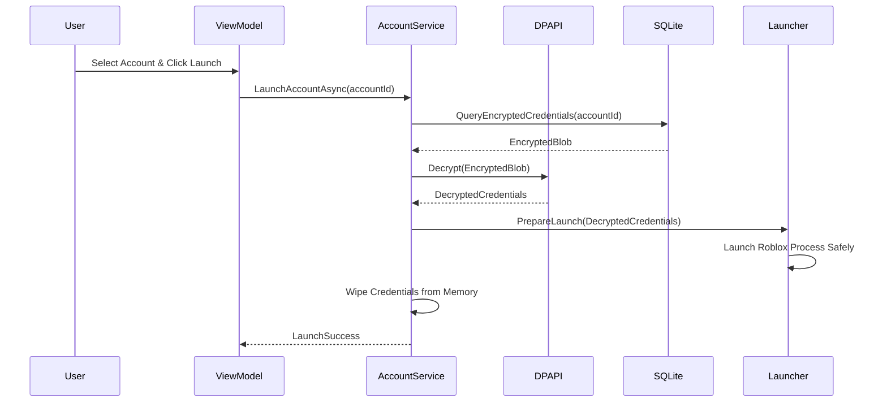

# Architecture Guide

## 1. System Overview

Secure Roblox Account Manager is structured using clean, layered architecture principles with MVVM (Model-View-ViewModel) for presentation separation.

---

## 2. Layer Responsibilities

### 2.1 Presentation (`RobloxAccountManager.App`)
- Houses modern WPF windows, pages, user controls, and navigation.
- Leverages `CommunityToolkit.Mvvm` (`ObservableObject`, `RelayCommand`).
- ViewModels handle presentation state and trigger Application use cases.
- **Rule:** ViewModels never touch SQLite or call raw cryptographic routines directly.

### 2.2 Application Layer (`RobloxAccountManager.Application`)
- Coordinates business workflows: `AddAccountUseCase`, `SwitchAccountUseCase`, `RefreshAvatarUseCase`.
- Encapsulates input validation rules.
- Dispatches domain events and manages asynchronous orchestrations.

### 2.3 Core Domain (`RobloxAccountManager.Core`)
- Contains enterprise business models (`Account`, `Profile`, `LaunchConfiguration`).
- Contains repository interfaces (`IAccountRepository`, `IEncryptionService`, `IRobloxLauncher`).
- Free from third-party dependencies to maximize long-term maintainability and testability.

### 2.4 Infrastructure (`RobloxAccountManager.Infrastructure`)
- **Database:** SQLite access utilizing parameterized commands via `Microsoft.Data.Sqlite`.
- **Security:** `DpapiEncryptionService` implementing Windows DPAPI with `DataProtectionScope.CurrentUser`.
- **Process Management:** `RobloxProcessLauncher` launching standard client paths via explicit parameter arrays, avoiding raw shell executions.
- **Logging:** Serilog logger configured with masking sinks for sensitive fields.

---

## 3. Security Boundaries & Data Flow

1. Credentials remain encrypted in the SQLite database file at all times.
2. Credentials are only decrypted into memory immediately prior to handoff.
3. Once the handoff completes, in-memory credential buffers are cleared.
