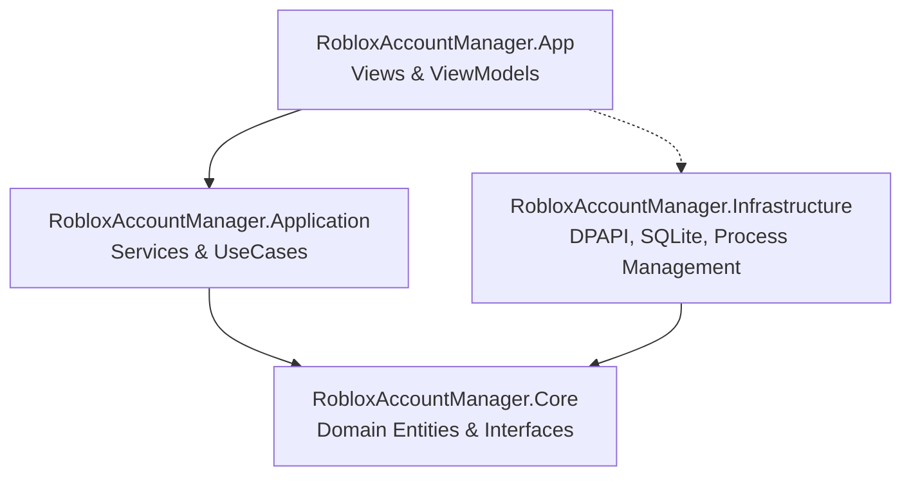
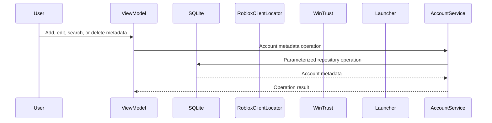

# Architecture Guide

## 1. System Overview

Secure Roblox Account Manager is structured using clean, layered architecture principles with MVVM (Model-View-ViewModel) for presentation separation.

---

## 2. Layer Responsibilities

### 2.1 Presentation (`RobloxAccountManager.App`)
- Houses modern WPF windows, pages, user controls, and navigation.
- Leverages `CommunityToolkit.Mvvm` (`ObservableObject`, `RelayCommand`).
- ViewModels handle presentation state and trigger Application use cases.
- **Rule:** ViewModels never touch SQLite or call raw cryptographic routines directly.

### 2.2 Application Layer (`RobloxAccountManager.Application`)
- Currently contains `AccountService`, which validates and coordinates account metadata CRUD with `IAccountRepository`.
- There is no account-switching, avatar-fetching, credential-handoff, or event-dispatch workflow implemented.

### 2.3 Core Domain (`RobloxAccountManager.Core`)
- Contains enterprise business models (`Account`, `Profile`, `LaunchConfiguration`).
- Contains repository interfaces (`IAccountRepository`, `IEncryptionService`, `IRobloxLauncher`).
- Free from third-party dependencies to maximize long-term maintainability and testability.

### 2.4 Infrastructure (`RobloxAccountManager.Infrastructure`)
- **Database:** SQLite access utilizing parameterized commands via `Microsoft.Data.Sqlite`.
- **Security:** `DpapiEncryptionService` implementing Windows DPAPI with `DataProtectionScope.CurrentUser`.
- **Process Management:** `RobloxProcessLauncher` rechecks Authenticode trust and uses `ProcessStartInfo.ArgumentList` with shell execution disabled.
- **Logging:** Serilog writes local rolling files; a configured enricher redacts matching patterns in top-level structured string properties only.

---

## 3. Security Boundaries & Data Flow

`IRobloxLauncher` and its infrastructure implementation are registered, but no current UI command invokes them. Direct launch behavior is covered by infrastructure tests only.

1. The account UI stores metadata only; account creation initializes an empty encrypted-secret blob.
2. The independent vault API uses DPAPI `CurrentUser` protection when explicitly called by a caller.
3. Roblox launching currently does not use the vault or inject authentication data.

